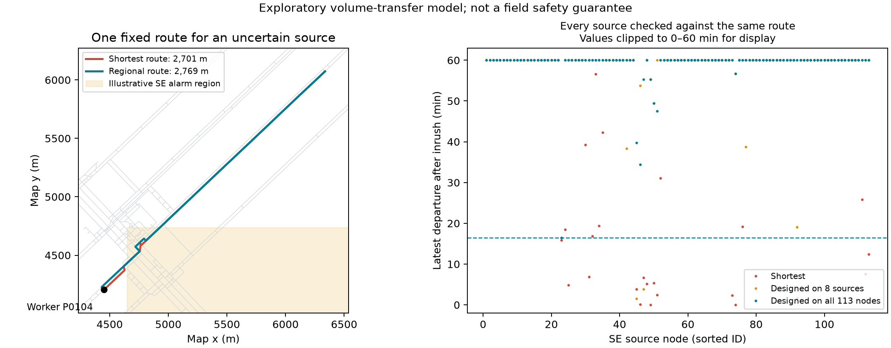

# 模糊分区警报下的固定逃生路线：探索结果

日期：2026-10-25。旧稿及之前实验均保留。本轮不成文为新论文，先检查用户提出的生产预案设定是否有实质结果。

## 核心发现

存在一个明确的有限情景正面案例：竞赛网络P0104收到“东南区突水”警报后，事先固定的一条2,768.58米路线，比干燥最短路线2,701.36米多67.23米（2.49%），可以覆盖该分区全部113个候选节点突水情景。模型内最晚共同出发时间为突水后987.91秒（16.47分钟）；使用更慢的干燥/顺水/逆水步速1.3/0.7/0.5m/s，仍有716.59秒（11.94分钟）。两套步速选择了同一条路线。

最短路线在其中某些情景下即使从事故发生时立即出发也无法走通。因此这是从“不能保证立即撤离也成功”提升到“能保证承受一定通知延迟”，不能把负的数学截止时刻解释为现实的负等待时间。

补充24个事先随机选定的巷道中点水源，不重新训练该路线：全部保留其16.47分钟/11.94分钟保证，未发现新的更差情景。但这只证明113节点加24中点的有限测试，不证明分区内每一个连续位置。

## 问题定义

一条路线只依赖人员位置和报警区域，不能依赖真实水源、未告知的延迟或未来观测。收到警报立即出发。以突水发生时刻为0，每个情景s给出路线P的最晚可行出发时刻D_s(P)。目标为：

    maximize min_s D_s(P), subject to length(P) <= (1+epsilon) * dry_shortest_length.

本轮把最晚出发的优化目标截在60分钟，所有0到保证时刻之间的出发均由FIFO、永久封闭假设推出可行。60分钟限制的是出发时间，不是整个撤离必须在事故后60分钟内完成。路线长度衡量绕行成本；水中步速影响实际行程。

保证仅相对于指定的情景集合与洪水模型。没有给候选水源赋予事故概率。通知是否确实正确指示区域，尚未建模。

## 实验设计与范围

1. 分别按网络节点坐标中位数分成四个地理象限，作为示意报警区域。这不是矿方确认的危险分区或传感器定位范围。
2. 每区随机固定8个设计水源和8个未见水源，共两个网络128次洪水模拟。使用原体积转移代理模型、Q=0.5m3/s与原封闭阈值。
3. 在每个区域检查所有可研究人员节点的最短路，再从设计情景下余量不足一小时的节点中固定随机选取最多12个；另保留最多4个基准最短路连立即出发都无法保证的点。排除出口、A及所有抽中的水源节点。不是全矿人员的代表性样本。
4. 共123个“人员位置＋报警区”组合，其中96个基准可行但余量低、27个基准立即出发不可保证。每组测试0%、5%、10%、20%长度预算，共492次优化，无超时。
5. 每条路线在所有水源情景下使用完全相同节点序列；未见水源不参与初始优化。

最短路按长度求解，与之前“指定突水点下的最快路”不同。不能直接混用两轮统计。

## 初始筛查：有改善，也有对水源样本的过拟合

下表分母均为设计时基准可行、余量低的48个组合。改善/恶化均指最差出发余量变化至少1分钟，比较时截在0–60分钟。

| 网络 | 额外长度预算 | 设计水源改善 | 未见水源改善 | 未见水源恶化 |
|---|---:|---:|---:|---:|
| 竞赛 | 5% | 38/48 | 14/48 | 4/48 |
| 竞赛 | 10% | 39/48 | 14/48 | 3/48 |
| 竞赛 | 20% | 40/48 | 14/48 | 4/48 |
| CAD | 5% | 37/48 | 4/48 | 6/48 |
| CAD | 10% | 43/48 | 8/48 | 6/48 |
| CAD | 20% | 46/48 | 9/48 | 6/48 |

未见情景的基准也可能不再可行，或本来已超过一小时，因此这些列不能视为独立样本成功概率。全部27个初始不可保证的组合保留在results.json；没有丢弃不利结果以凑分母。

## 完整节点覆盖改变了结论

P0104/东南区是从筛查结果中选出的探索案例，不是独立确认样本。

仅使用8个设计水源得到的固定路线，在额外8个水源下也看起来能承受至少一小时延迟。但把东南区所有113个非出口候选节点加入检查后，它在P0172突水时只剩89.88秒。少量水源验证不足以支持“整区保证”。

随后用全部113个节点重新优化，同一位置的长度—余量权衡如下：

| 长度预算 | 返回路线长度 | 4/2/1m/s下的保证 | 1.3/0.7/0.5m/s下的保证 |
|---|---:|---:|---:|
| 0% | 2,701.36米最短路 | 连立即出发都不能保证 | 连立即出发都不能保证 |
| 5% | 2,768.58米 | 16.47分钟 | 11.94分钟 |
| 10% | 2,768.58米 | 16.47分钟 | 11.94分钟 |
| 20% | 3,240.94米 | 至少约60分钟 | 至少约60分钟 |

5%与10%预算的最优值均被夹在宽度不足0.5秒的区间内，不是仅找到一条可行候选。20%达到设定的60分钟搜索上限，不宣称这是无限时最优值。

新路线相对最短路线绕开了两段脆弱分支。密集优化相对原抽样路线又改变一处局部分叉：从P0174–P0631–P0171改为P0174–P0172–P0171。两支长度接近，但面向不同水源的最差余量不同。结果依赖这些局部连接和水力传播规则，必须进一步核查其物理可信度。

24个巷道中点测试在密集节点路线固定后选定，没有据此再调路线。慢步速下中点情景最差余量仍超过68分钟，原步速下超过77分钟，所以这批中点没有降低节点情景给出的保证。不得把24个中点外推为连续区域证明。

图中负截止时刻显示为0，超过60分钟显示为60；0可能表示立即出发已不可行，60表示显示上限，并非准确截止时刻。

## 方法核查

实现长度与各水源下到达时刻的多标签搜索。一个标签只有在长度和每个情景到达时刻均不优于另一个标签时才被删除；使用每情景反向截止时刻及干燥剩余距离剪枝。在给定出发时刻下找最短的共同可行路径，再二分最大共同截止时刻。

该方法是现有资源约束/多情景路径思想的直接应用，不声称独创算法。100个随机六节点图、每图3个情景，与全简单路径枚举对照：400次可行性与最短长度比较，以及100次最优截止区间比较全部通过。每条实际返回路线另检查长度预算与设计情景行走可行性。

## 当前判断与下一步

这个方向已有值得继续的模型内结果：小幅绕行能够换来对多个突水位置共同有效的通知余量；同时，有限水源抽样可能给出严重过于乐观的预案。二者共同支持“区域警报下可靠固定路线”的研究问题。

还不能把它作为实际矿井安全收益：

- 使用的仍是原体积转移代理模型，路段均匀平均水深、分流/回水规则和永久封闭假设都未做工程校准。
- 更慢步速是敏感性值，不是实测人群行为模型。
- 地理象限不是地质风险区；任意节点单源、恒流条件不覆盖多源或时变流量。
- 完整枚举了一个区的节点，尚未完整覆盖连续源位置，也没有在两个网络所有区域上完成同等级验证。
- 数据中的几何连接、高程、出口定义仍需工程审核；节点情景不是独立事故观测。

下一阶段应优先在这些局部分支上验证水力时间表和细化水源位置，再决定是否扩大为论文。暂不加入路线菜单或假定事故概率，也不需要重新挖巷道。

## 复现

Python3.12，依赖原preprint的networkx、pandas、openpyxl、shapely及制图用matplotlib。命令从工作区根目录运行：

    python 实验_06_分区预警与固定路线_初期分析/prepare.py
    python 实验_06_分区预警与固定路线_初期分析/test_solver.py
    python 实验_06_分区预警与固定路线_初期分析/study.py
    python 实验_06_分区预警与固定路线_初期分析/dense.py
    python 实验_06_分区预警与固定路线_初期分析/dense_optimize.py
    python 实验_06_分区预警与固定路线_初期分析/midpoint_check.py
    python 实验_06_分区预警与固定路线_初期分析/summarize.py
    python 实验_06_分区预警与固定路线_初期分析/plot.py

必须等待prepare.py完成后再运行study.py。study.py会跳过screen.json中已完成的区域；准备和密集水源模拟复用该目录既有文件。要改协议，应使用新结果目录，不能混用旧缓存。

protocol.json在初始模拟前写入；各网络design.json存有其SHA-256。dense与midpoint属于初始筛查后的探索性验证，未冒充预注册。所有场景、路线、求解区间、失败类别和水量残差均保留。本机依赖路径为/tmp/mine-preprint-deps，可通过PYTHONPATH使用；它不是跨机器安装要求。
